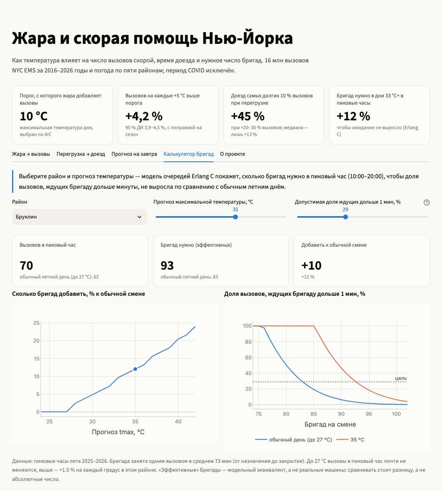
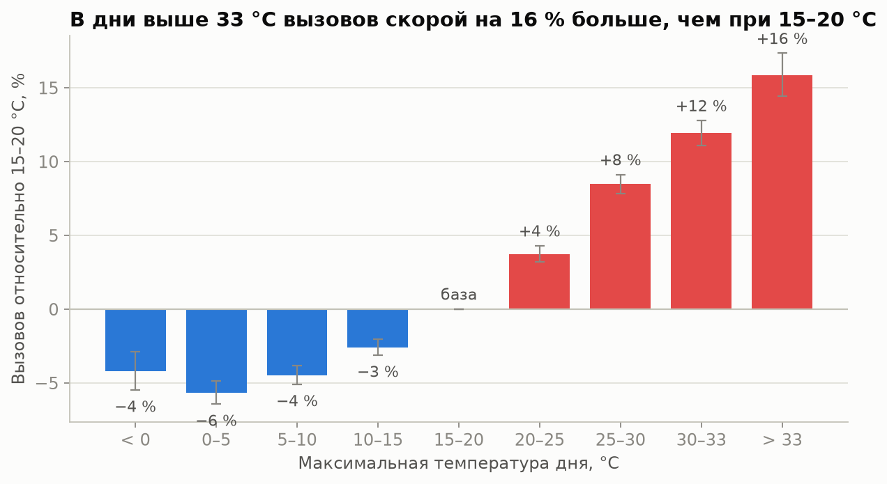
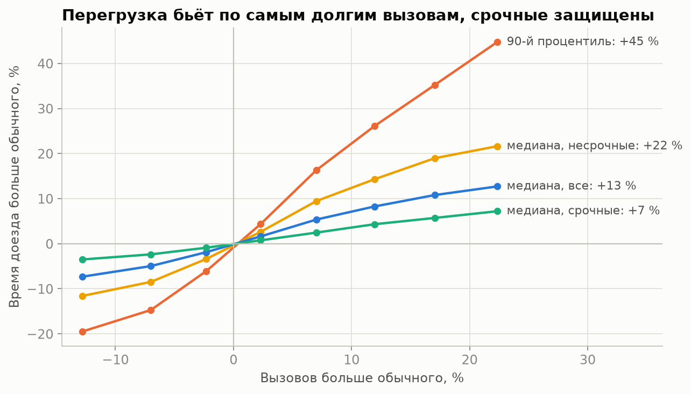
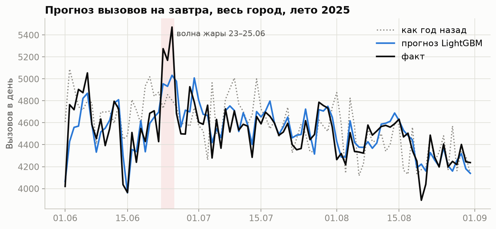
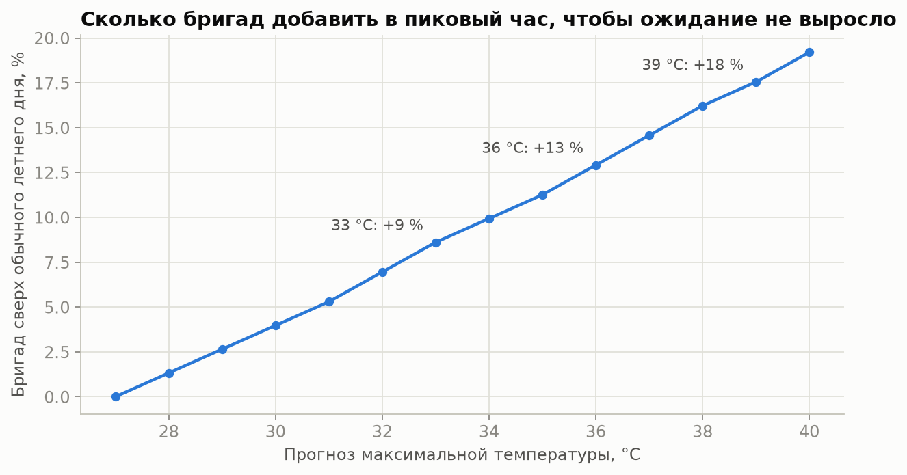

# Жара и скорая помощь Нью-Йорка

**Насколько жара увеличивает нагрузку на скорую помощь Нью-Йорка и на сколько бригад нужно увеличить смену, чтобы ожидание не ухудшалось?**

Анализ 16 млн вызовов NYC EMS за 2016–2026 годы вместе с погодой по пяти районам: регрессия Пуассона, ML-прогноз на завтра, интерпретация через SHAP и расчёт бригад по теории очередей (Erlang C). Результаты собраны в интерактивном дашборде на Streamlit.



## Главные результаты

| Гипотеза | Результат |
|---|---|
| **H1.** Выше порога температуры вызовов становится больше | ✅ Порог **10 °C** (максимальная температура дня). Выше него **+4,2 % вызовов на каждые +5 °C** (95 % ДИ 3,9–4,5 %) с поправкой на сезон, день недели, год и праздники. В дни выше 33 °C вызовов на **16 %** больше, чем при 15–20 °C |
| **H2.** Время доезда растёт нелинейно | ⚠️ Подтверждается **только для «хвоста»**. Медиана доезда растёт пропорционально нагрузке: +1 % вызовов даёт +0,7 %. А 90-й процентиль при перегрузке на 20–30 % растёт на **~45 %**. Срочные вызовы защищены приоритетом диспетчеров, расплачиваются несрочные |
| **H3.** ML-прогноз на завтра точнее простого правила, температура важна | ✅ LightGBM: ошибка **4,7 %** по району и **2,7 %** по городу против 7,0 % и 4,9 % у правила «как год назад». Погода снижает ошибку в жаркие дни на 14 %. Температура — самый важный погодный признак, но главные признаки — вызовы последних дней |
| **H4.** Прогноз вызовов можно перевести в число бригад | ✅ По Erlang C в дни 33 °C+ нужно **+12 % бригад** в пиковые часы, чтобы доля ждущих бригаду дольше минуты не выросла; при 38–40 °C нужно +16–19 % |

**Сравнение с литературой.** В мета-анализе Xu et al. (2023) вызовов скорой становится на 7 % (5–10 %) больше на каждые +5 °C *средней* суточной температуры. Наши +4,2 % посчитаны на 5 °C *максимальной* температуры, поэтому сравнение приблизительное, но порядок величин совпадает. Лондонское исследование (Mahmood et al., 2017) тоже показывает, что жара ухудшает доезд в основном через рост числа вызовов.

<p>




</p>

## Данные

| Данные | Источник | Период |
|---|---|---|
| Вызовы скорой, ~16 млн | [NYC Open Data — EMS Incident Dispatch Data](https://data.cityofnewyork.us/Public-Safety/EMS-Incident-Dispatch-Data/76xm-jjuj) (SoQL API) | 01.2016 – 09.2026 |
| Погода по 5 районам | [Open-Meteo Historical API](https://open-meteo.com/en/docs/historical-weather-api), реанализ ERA5 | 01.2016 – 09.2026 |

Из данных убраны дежурства бригад (`STNDBY`) и вызовы без района: это 0,26 % записей. Период COVID (03.2020 – 02.2022) отмечен флагом и в модели не входит.

## Как устроен проект

| Ноутбук | Что внутри |
|---|---|
| [`01_eda`](notebooks/01_eda.ipynb) | Разведочный анализ на SQL (DuckDB): тренд, сезонность, день недели, первая «клюшка» |
| [`02_dataset`](notebooks/02_dataset.ipynb) | Сборка таблицы «день × район»: очистка, погода, календарь, флаг COVID |
| [`03_h1_poisson`](notebooks/03_h1_poisson.ipynb) | **H1.** Регрессия Пуассона, контроль конфаундеров, поиск порога по AIC, сверхдисперсия и устойчивые ошибки |
| [`04_h2_response`](notebooks/04_h2_response.ipynb) | **H2.** Нагрузка и время доезда: медиана, 90-й процентиль, срочность, пиковые часы |
| [`05_h3_forecast`](notebooks/05_h3_forecast.ipynb) | **H3.** LightGBM, разбиение по времени, сравнение с базовыми правилами, permutation importance |
| [`06_shap`](notebooks/06_shap.ipynb) | SHAP: форма эффекта температуры; почему деревья не годятся для сценариев «+5 °C» |
| [`07_erlang_c`](notebooks/07_erlang_c.ipynb) | **H4.** Теория очередей: калибровка Erlang C и расчёт бригад для жары и сценария «+5 °C» |

```
heat-ems-nyc/
├── app.py                  ← дашборд Streamlit
├── notebooks/              ← анализ по этапам
├── src/
│   ├── download_ems.py         загрузка вызовов через API NYC Open Data
│   ├── download_weather.py     загрузка погоды через Open-Meteo
│   ├── forecast.py             признаки и модель прогноза
│   ├── queueing.py             формулы Erlang C
│   ├── build_dashboard_data.py таблицы для дашборда
│   └── make_figures.py         графики для README
├── data/processed/         ← итоговые таблицы (сырые данные в Git не хранятся)
└── reports/                ← графики и текст «О проекте»
```

## Запуск

Нужен [uv](https://docs.astral.sh/uv/).

```bash
uv sync                                     # установить зависимости
uv run streamlit run app.py                 # открыть дашборд (данные уже в data/processed)
```

Чтобы пересчитать всё с нуля:

```bash
uv run python src/download_ems.py           # ~16 млн вызовов, долго
uv run python src/download_weather.py
# затем по порядку выполнить notebooks/01 … 07
uv run python src/build_dashboard_data.py
uv run python src/make_figures.py
```

## Ограничения

- Мы видим **связь**, а не доказанную причину: в жару меняется не только температура.
- Погода взята из реанализа ERA5, а не с метеостанций. Для прогноза использована фактическая погода; с реальным прогнозом погоды ошибка будет немного выше.
- Erlang C предполагает одинаковые бригады, случайный поток вызовов и общую очередь. Он не учитывает географию, приоритеты, переброски между районами и изменение потока внутри часа. Реального числа бригад в открытых данных нет, поэтому мы считаем «эффективные» бригады и сравниваем **разницу** между обычным днём и жарой, а не абсолютные числа.

## Стек

Python · pandas · SQL (DuckDB) · REST API · statsmodels · scikit-learn · LightGBM · SHAP · теория массового обслуживания (Erlang C) · Plotly · Streamlit · Jupyter · Git · uv

## Источники

- Xu Z. et al. *Heat, heatwaves, and ambulance service use: a systematic review and meta-analysis of epidemiological evidence.* Int J Biometeorol, 2023, 67(10):1523–1542. [PubMed](https://pubmed.ncbi.nlm.nih.gov/37495745/)
- Mahmood M. A. et al. *Impact of Air Temperature on London Ambulance Call-Out Incidents and Response Times.* Climate, 2017, 5(3):61. [MDPI](https://www.mdpi.com/2225-1154/5/3/61)
- Williams S. et al. Вызовы скорой в Аделаиде при жаре. Sci Total Environ, 2012, 414:126–133.
- Green L. V., Kolesar P. J., Whitt W. *Coping with time-varying demand when setting staffing requirements for a service system.* Production and Operations Management, 2007, 16(1):13–39.
- Restrepo M., Henderson S. G., Topaloglu H. *Erlang loss models for the static deployment of ambulances.* Health Care Management Science, 2009, 12(1):67–79.
